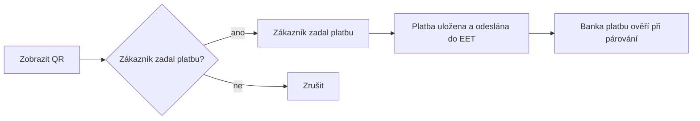

# 121. EET - evidence tržeb

> Evidence tržeb EET 2.0: příprava u Finanční správy, nastavení firmy, přijetí platby u faktury, QR platba na místě, sledování odeslaných tržeb a opravy.

## Co je EET 2.0 a koho se týká

EET 2.0 je evidence tržeb, které podnikatel přijme za prodej. Evidují se platby podle jejich skutečných okolností, typicky hotovost, platba kartou na terminálu a QR platba, kterou zákazník zadá přímo na místě. Samotné vystavení faktury není přijetí platby. Běžný bankovní převod, který zákazník zaplatí sám z domova, se posuzuje jinak a obvykle se neeviduje.

Rozsah povinnosti, výjimky a harmonogram popisují oficiální stránky [eet.gov.cz](https://eet.gov.cz). Zda se vás evidence týká, ověřte tam. MyÚčto vám pomůže evidenci technicky vést, o povinnosti firmy ale nerozhoduje.

Hotovostní příjmové doklady v Pokladně se při zaúčtování evidují na pokladní zařízení přiřazené k pokladně.

## Co připravit u Finanční správy

Než nastavíte EET v MyÚčtu, potřebujete od Finanční správy evidenční jednotky a pokladní certifikát.

1. Otevřete portál [MOJE daně](https://www.mojedane.cz) a vyberte **Online finanční úřad**.
2. Otevřete DIS+ (daňovou informační schránku) správného subjektu. Pokud spravujete více firem, zkontrolujte název a identifikaci právě otevřené firmy.
3. V DIS+ se přihlaste k **Elektronické evidenci tržeb** (EET).
4. V části **Evidenční jednotky** zadejte místa, kde tržby přijímáte (provozovna, vozidlo, internetový obchod a podobně). Finanční správa jim přidělí čísla.
5. Otevřete **Správu pokladních certifikátů** a požádejte o certifikát.
6. Po vydání uložte soubor **.p12** a jeho **heslo**. Převzetí certifikátu potvrďte až po bezpečném uložení obou údajů, původní soubor už pak nemusí jít znovu stáhnout.

Pokladní certifikát obsahuje soukromý klíč. Neposílejte jej běžným e-mailem a nesdílejte jej s lidmi, kteří jej nepotřebují spravovat. Přihlašovací údaje do DIS+, datové schránky ani bankovní identity se do MyÚčta nezadávají.

Oficiální postupy najdete v průvodci [Jak začít evidovat](https://eet.gov.cz/cs/zacinam-s-eet/jak-zacit-evidovat) a v přehledu [Chyby a jejich řešení](https://eet.gov.cz/cs/zacinam-s-eet/chyby-a-jejich-reseni).

## Nastavení v MyÚčtu

Nastavení najdete v nabídce **Firma → EET** (stránka **EET - evidence tržeb**). Průvodce **Jak začít s EET** na stránce ukazuje kroky odshora dolů a hotové kroky označí zeleně. Evidenci půjde zapnout až po splnění všech podmínek.

### Profil EET

| Pole | Význam |
|---|---|
| **Prostředí** | **Playground (zkušební)** nebo **Produkce**. Playground nemá žádné daňové účinky. Při zapnuté evidenci nelze prostředí měnit, nejdřív evidenci vypněte. Přepnutí na produkci potvrdíte v dialogu **Přepnout na produkci?**. |
| **DIČ poplatníka (EIČ)** | Například CZ12345678. Musí odpovídat DIČ v pokladním certifikátu. |
| **Režim** | **Běžný režim** (tržby se evidují), **Zákonné vynětí** (uvedete **Důvod vynětí**, evidence se nezapíná) nebo **EET OFF** (evidence je vypnutá). |
| **Evidence účinná od** | Od tohoto data se tržby evidují. |
| **Mezní doba odezvy (ms)** | Od 2000 do 10000 ms, zákonné minimum jsou 2 sekundy. |

### Evidenční jednotky

V sekci **Evidenční jednotky** přes **Přidat jednotku** zadáte **Číslo jednotky (id_provoz)** z DIS+, **Název**, **Typ jednotky** (provozovna, internetový obchod, vozidlo, mobilní, jiné) a období účinnosti. Jednotku lze příznakem označit jako oznámenou finanční správě. Akce **Ukončit** ukončí účinnost jednotky k dnešnímu dni, jednotka zůstane v historii.

### Pokladní zařízení

V sekci **Pokladní zařízení** přes **Přidat zařízení** založíte logickou pokladnu s **Kódem zařízení (id_pokl)**, například WEB-01. Kód má nejvýše 20 znaků a patří vždy k jedné evidenční jednotce, proto nejdřív založte jednotku. Jedno zařízení nastavte akcí **Nastavit jako výchozí**. Číselná řada účtenek se vede po zařízeních. Nepotřebné zařízení vyřadíte akcí **Deaktivovat**, nové tržby na něj pak nepůjde evidovat.

### Pokladní certifikáty

V sekci **Pokladní certifikáty** přes **Nahrát certifikát** vyberete **Prostředí**, soubor **.p12**, zadáte **Heslo certifikátu** a případně nepovinný popisek. Certifikát se zvlášť nahrává pro Playground a pro produkci. Nahrání vyžaduje opětovné ověření vaší identity (heslem, kódem z autentizační aplikace nebo přístupovým klíčem). Soukromý klíč i heslo se ukládají šifrovaně a nikdy se nezobrazují. V tabulce vidíte DIČ, datum platnosti (**Platí do**) a stav **Aktivní**, **Neplatný** nebo **Vyřazený**.

### Diagnostika a aktivace

1. V sekci **Diagnostika spojení** vyberte zařízení (nebo **Výchozí zařízení**) a stiskněte **Ověřit nastavení**. Ověření proběhne v ověřovacím režimu a kontroluje identitu, certifikát a dostupnost. Evidenci tržby nezapisuje. Před ověřením musíte uložit změny profilu.
2. V sekci **Aktivace evidence** stiskněte **Aktivovat evidenci**. Pokud evidenci zatím nelze zapnout, stránka vypíše překážky v seznamu **Evidenci zatím nelze zapnout**. Zapnutí produkční evidence potvrdíte v dialogu **Zapnout ostrou evidenci?**.
3. Evidenci vypnete akcí **Deaktivovat evidenci**, nové tržby se pak přestanou evidovat.

Zkušební prostředí je dobré vyzkoušet před ostrým provozem. Záznamy z Playgroundu nejsou evidencí tržby a v seznamech jsou označené jako testovací.

## Přijetí platby u faktury

U vystavené faktury s nezaplacenou částkou je při zapnuté evidenci k dispozici akce **Přijmout platbu**. Otevře se dialog, ve kterém vyplníte:

- **Částku**, předvyplněná je zbývající část k úhradě (**Zbývá uhradit**),
- **Způsob platby**,
- **Okolnosti platby**: **Osobně u zákazníka**, **V provozovně**, **Ve vozidle** nebo **Na dálku**,
- **Pokladní zařízení** (výchozí je **Výchozí zařízení firmy**, zvolené zařízení si prohlížeč pro firmu zapamatuje),
- **Čas přijetí platby**, ze kterého se odvozuje **Datum úhrady v účetnictví**, a případně **Poznámku**.

Dialog po chvíli sám vyhodnotí, zda se platba eviduje, a zobrazí jednu z hlášek: **Tato platba se zaeviduje do EET.**, **Tato platba nepodléhá evidenci EET.**, **Tento scénář zatím nelze evidovat.** nebo **Platbu nelze v tomto nastavení přijmout.**. Rozhodnutí vždy činí server podle způsobu a okolností platby.

| Způsob platby | Co se stane |
|---|---|
| **Hotově** | Platba se zaeviduje, pokud ji server podle okolností posoudí jako evidovanou tržbu. |
| **Karta na terminálu - potvrzuji, že platba proběhla** | Potvrzujte až po schválení platby na terminálu. Aplikace platbu karty sama neověřuje. |
| **Bankovní převod (zákazník platí sám)** | Zákazník platí sám, typicky z domova. Taková platba se běžně neeviduje. |
| **QR platba na místě u zákazníka** | Dialog nabídne **Pokračovat na QR platbu**, viz následující kapitola. |

Po uložení dialog ukáže tři oddělené stavy: **Peníze** (například **Přijato** nebo **Přijetí peněz bankou zatím neověřeno**), **Úhrada dokladu** (**Doklad uhrazen** nebo **Úhrada dokladu čeká na bankovní párování**) a **EET**. Pokud spojení s finanční správou chvíli nejde, platba zůstane uložená a odeslání do EET počká na obnovení spojení. Při přerušeném spojení se serverem odešlete platbu znovu tlačítkem **Zkusit odeslat znovu**, nevznikne duplicita.

Na detailu faktury najdete sekci **EET** se seznamem evidencí k dané faktuře (čas, částka, stav platby a stav EET) a odkazem **Detail záznamu**. Platbu při zapnuté EET nelze přijmout jinou cestou než přes **Přijmout platbu**, protože je nutné zadat okolnosti platby.

## Platba QR na místě

Tuto cestu využijete například jako řemeslník, který vystaví fakturu přímo u zákazníka a ten hned zaplatí QR kódem.

1. Na detailu faktury zvolte **Platba QR na místě (EET)** (nebo v dialogu přijetí platby způsob **QR platba na místě u zákazníka** a **Pokračovat na QR platbu**).
2. Stiskněte **Zobrazit QR** a ukažte kód zákazníkovi. K dispozici je i **Kopírovat platební údaje**. Zobrazení QR nic neeviduje a fakturu neoznačí za zaplacenou.
3. Jakmile zákazník ve svém bankovnictví zadá platbu, stiskněte **Zákazník zadal platbu**.
4. Teprve tím vznikne záznam o platbě a spustí se evidence EET. Pokud zákazník platbu nezadal, použijte **Zrušit**.

Potvrzení obsluhy není bankovní potvrzení. U platby zůstane stav **Přijetí peněz bankou zatím neověřeno**, dokud platbu neověří bankovní párování. Párování EET znovu neodesílá.

## Při vystavení rovnou přijmout platbu

V editoru faktury je u vystavované faktury sekce **Platba při vystavení (EET)** s volbami:

- **Jen vystavit fakturu, platba přijde později**,
- **Při vystavení rovnou přijmout platbu**,
- **Platba QR na místě (EET)**.

Po vystavení se otevře odpovídající dialog s předvyplněnou částkou. Zda se platba eviduje, rozhodne server podle okolností platby.

## Evidence EET

Přehled evidovaných tržeb najdete v nabídce **Evidence EET**. Nahoře jsou souhrnné karty a pod nimi filtry (**Od**, **Do**, **Stav**, **Jednotka**, **Zařízení**, **Vyžaduje zásah**) a tabulka záznamů s časem tržby, číslem, jednotkou a zařízením, částkou, stavem a lhůtou. Tlačítkem **Export CSV** záznamy vyexportujete.

| Karta | Význam |
|---|---|
| **Čeká ve frontě** | Záznamy čekající na odeslání nebo opakování. |
| **Vyžaduje zásah** | Záznamy, které se samy nevyřeší. Kliknutím je zobrazíte. |
| **Po lhůtě 48 h** | Neodeslané tržby po zákonné lhůtě. |
| **Nejstarší lhůta** | Termín nejstaršího neodeslaného záznamu. |
| **Poslední úspěch** | Čas posledního potvrzeného odeslání. |
| **Platnost certifikátu** | Nejdříve končící certifikát. |

Záznam má jeden z těchto stavů:

| Stav | Význam |
|---|---|
| **Čeká na odeslání** | Záznam je uložen a čeká na odeslání. |
| **Odesílá se** | Právě probíhá odeslání. |
| **Čeká na obnovení spojení** | Odeslání se nepodařilo, systém zkouší znovu. |
| **Potvrzeno (POK)** | Finanční správa zprávu přijala a vydala potvrzení. |
| **Potvrzeno s varováním** | Zpráva byla přijata, finanční správa k ní připojila varování. |
| **Ověřeno** | Ověřovací odeslání proběhlo v pořádku. |
| **Vyžaduje zásah** | Odeslání finanční správa odmítla nebo vyžaduje opravu nastavení či údajů. |
| **Nepodléhá evidenci** | Platba se podle pravidel neeviduje. |

Tržba se musí odeslat bezodkladně po odstranění příčiny, nejpozději do 48 hodin. Záznam po lhůtě je označen **Po lhůtě**. Pokud je odesílání zablokované, stránka zobrazí upozornění, ať zkontrolujete nastavení a certifikát ve **Firma → EET**.

Detail záznamu (**Záznam EET**) ukazuje obsah tržby, varování finanční správy, důvod evidence a zdrojové doklady, opravy a **Historii pokusů** o odeslání včetně výsledku, kódu a XML pokusu. Záznam, který čeká nebo vyžaduje zásah, lze znovu odeslat tlačítkem **Odeslat znovu**.

## Opravy a vratky

Potvrzený záznam se nemaže ani nepřepisuje. Opravuje se novým záporným záznamem. V detailu záznamu stiskněte **Opravit / vrátit**, v dialogu zadejte **Částku opravy** (prázdné pole znamená celou dosud neopravenou část) a **Důvod**: **Vratka zákazníkovi**, **Platba neproběhla**, **Chybné údaje**, **Duplicitní záznam** nebo **Jiný důvod**. Dialog ukáže **Navrženou opravu**, **Dosud opraveno** a **Zbývá opravit**. Po **Zaevidovat opravu** vznikne záznam s vlastním číslem a aktuálním časem, v přehledu označený **Oprava**.

Oprava mění jen evidenci. Vrácení peněz zákazníkovi je potřeba provést a zaúčtovat zvlášť.

Úhradu, ke které existuje záznam EET, nelze smazat. Chybnou evidenci opravte zápornou opravou v **Evidenci EET**.

## Výměna certifikátu a upozornění na expiraci

Platnost certifikátu hlídají tabulka v sekci **Pokladní certifikáty** (sloupec **Platí do** a počet zbývajících dní) a karta **Platnost certifikátu** v **Evidenci EET**. Blížící se konec platnosti označují stavy **Brzy vyprší**, **Vyprší za pár dní** a **Prošlý**. Prošlý certifikát odesílání tržeb zablokuje.

Postup výměny:

1. V DIS+ požádejte ve **Správě pokladních certifikátů** o nový certifikát a po uložení souboru .p12 a hesla potvrďte převzetí.
2. V **Firma → EET** nahrajte nový certifikát přes **Nahrát certifikát** pro stejné prostředí.
3. Spusťte **Ověřit nastavení**.
4. Starý certifikát můžete akcí **Deaktivovat** vyřadit.

Nový certifikát nahrajte s předstihem, ještě než ten stávající vyprší.

## Časté otázky

**Znamená POK, že je faktura zaplacená?** Ne. POK je potvrzení, že finanční správa přijala zprávu o tržbě. Zaplacení peněz a potvrzení EET jsou dva různé stavy, dialog je proto ukazuje odděleně.

**Vytvoří bankovní párování druhou evidenci?** Ne. Pozdější párování bankovní platby platbu jen ověří a propojí. EET se kvůli tomu znovu neodesílá.

**Jak se eviduje záloha a doplatek?** Posuzuje se každá platba zvlášť. Záloha a doplatek jsou dvě samostatné tržby. Vystavení konečné faktury už přijaté peníze znovu neeviduje.

**Je evidence v Playgroundu skutečná evidence?** Ne. Zkušební prostředí slouží k vyzkoušení, záznamy z něj nemají daňové účinky a jsou označené jako testovací. Ostrou evidenci zahájíte až po přepnutí na produkci s produkčním certifikátem.

**Zákazník zaplatil převodem z domova. Eviduje se to?** Běžný převod, který zákazník zadá sám, se obvykle neeviduje. V dialogu přijetí platby zvolte **Bankovní převod (zákazník platí sám)** a server posoudí okolnosti.

**Odeslání se nepodařilo, co dělat?** Platba je uložená a systém odeslání opakuje. Nejpozději do 48 hodin musí být tržba odeslána. V **Evidenci EET** zkontrolujte stav, případně certifikát, a zkuste **Odeslat znovu**.
