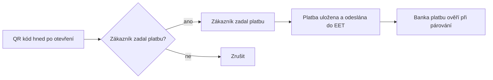

# 121. EET 2.0 - evidence tržeb

> Evidence tržeb EET 2.0: příprava u Finanční správy, nastavení firmy, přijetí platby u faktury, QR platba na místě, sledování odeslaných tržeb a opravy.

## Co je EET 2.0 a koho se týká

EET 2.0 je evidence tržeb, které podnikatel přijme za prodej. Evidují se platby podle jejich skutečných okolností, typicky hotovost, platba kartou na terminálu a QR platba, kterou zákazník zadá přímo na místě. Samotné vystavení faktury není přijetí platby. Běžný bankovní převod, který zákazník zaplatí sám z domova, se posuzuje jinak a obvykle se neeviduje.

Rozsah povinnosti, výjimky a harmonogram popisují oficiální stránky [eet.gov.cz](https://eet.gov.cz). Zda se vás evidence týká, ověřte tam. MyÚčto vám pomůže evidenci technicky vést, o povinnosti firmy ale nerozhoduje.

Hotovostní příjmové doklady v Pokladně se při zaúčtování evidují na pokladní zařízení přiřazené k pokladně, a když pokladna žádné přiřazené nemá, na výchozí zařízení firmy. Bez zařízení doklad nejde zaúčtovat, v **Nastavení EET** pokladně zařízení přiřaďte. Čas tržby se bere z dokladu: u dokladu s dnešním datem okamžik zaúčtování, u staršího čas pořízení dokladu v den vystavení, jinak poledne dne vystavení. Pozdě zaúčtovaný doklad se zaeviduje s označením po lhůtě.

## Co připravit u Finanční správy

Než nastavíte EET v MyÚčtu, potřebujete od Finanční správy evidenční jednotky a pokladní certifikát. Finanční správa tyto služby zpřístupňuje v DIS+ od 1. 11. 2026, běžná evidence tržeb začíná 1. 1. 2027.

### Přihlášení do DIS+

1. Otevřete portál [MOJE daně](https://www.mojedane.cz) a vyberte **Online finanční úřad**.
2. Přihlaste se. Nejčastěji Identitou občana (bankovní identita, mobilní klíč eGovernmentu, eObčanka) nebo datovou schránkou. Kdo nemá ani jedno, může si u Finanční správy vyžádat přístupové údaje, postup je v oficiálním průvodci.
3. Otevřete DIS+ (daňovou informační schránku) správného subjektu. U firmy (právnické osoby) jedná statutární orgán nebo osoba s pověřením, nestačí zůstat ve vlastní osobní schránce přihlášeného člověka. Pokud spravujete více firem, zkontrolujte název a identifikaci právě otevřené firmy.
4. Pokud DIS+ ještě nemáte, aktivujte ji. Aktivace obvykle trvá do 48 hodin, u subjektu, který dosud nic nepodával, může trvat až 5 pracovních dnů.

### Přihlášení k EET a evidenční jednotky

1. V DIS+ se přihlaste k **Elektronické evidenci tržeb** (EET).
2. V části **Evidenční jednotky** oznamte místa, kde tržby přijímáte: provozovnu, internetový obchod nebo aplikaci, vozidlo, případně činnost mimo ostatní jednotky (například řemeslník u zákazníků). Finanční správa jim přidělí čísla. Tato čísla do MyÚčta později jen opíšete, nevymýšlejte vlastní.
3. Pokud v alespoň jedné jednotce přijímáte evidované tržby, oznamte i ostatní jednotky, ve kterých tržby vznikají. Změnu jednotek oznamte před první tržbou po změně, nejpozději do 15 dnů.

### Vydání pokladního certifikátu

1. Z DIS+ otevřete aplikaci **Správa pokladních certifikátů EET**. Podmínkou je alespoň jedna evidenční jednotka.
2. Požádejte o nový certifikát. Vyplňte srozumitelné označení (například „MyÚčto“) a kontaktní e-mail, na který přijdou upozornění na blížící se konec platnosti.
3. Po vydání stáhněte soubor **.p12** a opište nebo zkopírujte jeho **heslo**. Soubor obsahuje certifikát i soukromý klíč.
4. Převzetí certifikátu potvrďte až po bezpečném uložení souboru i hesla. Po potvrzení nebo po 30 dnech už původní soubor znovu stáhnout nejde.

Certifikát platí 366 dnů, přesné datum konce uvidíte v MyÚčtu. Jeden certifikát mohou používat všechna pokladní zařízení téže firmy. Pokladní certifikát není certifikát datové schránky ani váš osobní elektronický podpis.

Pokladní certifikát obsahuje soukromý klíč. Neposílejte jej běžným e-mailem a nesdílejte jej s lidmi, kteří jej nepotřebují spravovat. Při podezření na únik certifikát ve Správě pokladních certifikátů zneplatněte a vydejte nový, pouhé smazání v MyÚčtu nestačí. Přihlašovací údaje do DIS+, datové schránky ani bankovní identity se do MyÚčta nezadávají.

Oficiální postupy najdete v průvodci [Jak začít evidovat](https://eet.gov.cz/cs/zacinam-s-eet/jak-zacit-evidovat) a v přehledu [Chyby a jejich řešení](https://eet.gov.cz/cs/zacinam-s-eet/chyby-a-jejich-reseni).

## Nastavení v MyÚčtu

Nastavení najdete v nabídce **Firma → EET nastavení** (stránka **EET 2.0 - evidence tržeb**). Průvodce **Jak začít s EET** na stránce ukazuje kroky odshora dolů a hotové kroky označí zeleně. Evidenci půjde zapnout až po splnění všech podmínek.

### Profil EET

| Pole | Význam |
|---|---|
| **Prostředí** | **Playground (zkušební)** nebo **Produkce**. Playground nemá žádné daňové účinky. Při zapnuté evidenci nelze prostředí měnit, nejdřív evidenci vypněte. Přepnutí na produkci potvrdíte v dialogu **Přepnout na produkci?**. |
| **EIČ (DIČ poplatníka pro EET)** | Například CZ12345678. Převezměte ho z DIS+ nebo z certifikátu, u fyzické osoby se může lišit od DIČ pro DPH. Musí odpovídat EIČ v pokladním certifikátu. |
| **Režim** | **Běžný režim** (tržby se evidují), **Zákonné vynětí** (uvedete **Důvod vynětí**, evidence se nezapíná) nebo **EET OFF** (evidence je vypnutá). |
| **Evidence účinná od** | Od tohoto data se tržby evidují. |
| **Mezní doba odezvy (ms)** | Od 2000 do 10000 ms, zákonné minimum jsou 2 sekundy. |

### Evidenční jednotky

V sekci **Evidenční jednotky** přes **Přidat jednotku** zadáte **Číslo jednotky (id_jednotky)** z DIS+, **Název**, **Typ jednotky** (provozovna, internetový obchod, vozidlo, mobilní, jiné) a období účinnosti. Jednotku lze příznakem označit jako oznámenou finanční správě. Akce **Ukončit** ukončí účinnost jednotky k dnešnímu dni, jednotka zůstane v historii.

### Pokladní zařízení

V sekci **Pokladní zařízení** přes **Přidat zařízení** založíte logickou pokladnu s **Kódem zařízení (id_pokl)**, například WEB-01. Kód má nejvýše 20 znaků a patří vždy k jedné evidenční jednotce, proto nejdřív založte jednotku. Jedno zařízení nastavte akcí **Nastavit jako výchozí**. Číselná řada účtenek se vede po zařízeních. Nepotřebné zařízení vyřadíte akcí **Deaktivovat**, nové tržby na něj pak nepůjde evidovat.

### Pokladní certifikáty

Certifikát nahrává uživatel s právem správy pokladních certifikátů EET, typicky správce firmy:

1. Zkontrolujte v přepínači firem, že máte otevřenou správnou firmu. Certifikát se nahraje vždy jen do ní.
2. V sekci **Pokladní certifikáty** klikněte na **Nahrát certifikát**.
3. Vyberte **Prostředí**: **Produkce** pro certifikát z DIS+, **Playground (zkušební)** jen pro veřejné testovací certifikáty Finanční správy.
4. Přes **Vybrat soubor** zvolte soubor **.p12** a do pole **Heslo certifikátu** zadejte heslo, které jste získali spolu s ním. Popisek je nepovinný.
5. Potvrďte svou identitu (heslem k MyÚčtu, kódem z autentizační aplikace nebo přístupovým klíčem) a klikněte na **Nahrát**.

MyÚčto při nahrání ověří heslo, soukromý klíč, vydavatele (certifikační autoritu EET), prostředí, platnost a shodu EIČ v certifikátu s EIČ v profilu. Pokud něco nesedí, certifikát odmítne s popisem důvodu. Soukromý klíč i heslo se ukládají šifrovaně, nikdy se nezobrazují a nejdou stáhnout zpět. Pokladní nepotřebují znát heslo certifikátu, tržby podepisuje server.

V tabulce vidíte prostředí, EIČ, datum platnosti (**Platí do**) a stav **Aktivní**, **Neplatný** nebo **Vyřazený**. Certifikát, který už nepoužíváte, vyřadíte akcí **Deaktivovat**. Deaktivace v MyÚčtu certifikát u Finanční správy nezneplatní.

### Diagnostika a aktivace

1. V sekci **Diagnostika spojení** vyberte zařízení (nebo **Výchozí zařízení**) a stiskněte **Ověřit nastavení**. Ověření proběhne v ověřovacím režimu a kontroluje identitu, certifikát a dostupnost. Evidenci tržby nezapisuje. Před ověřením musíte uložit změny profilu.
2. V sekci **Aktivace evidence** stiskněte **Aktivovat evidenci**. Pokud evidenci zatím nelze zapnout, stránka vypíše překážky v seznamu **Evidenci zatím nelze zapnout**. Zapnutí produkční evidence potvrdíte v dialogu **Zapnout ostrou evidenci?**.
3. Evidenci vypnete akcí **Deaktivovat evidenci**, nové tržby se pak přestanou evidovat.

Zkušební prostředí je dobré vyzkoušet před ostrým provozem. Záznamy z Playgroundu nejsou evidencí tržby a v seznamech jsou označené jako testovací.

## Přijetí platby u faktury

U vystavené faktury s nezaplacenou částkou je při zapnuté evidenci k dispozici akce **Přijmout platbu**. Otevře se dialog, ve kterém vyplníte:

- **Částku**, předvyplněná je zbývající část k úhradě (**Zbývá uhradit**),
- **Způsob platby**,
- **Okolnosti platby**: **Osobně u zákazníka**, **V provozovně**, **Ve vozidle** nebo **Na dálku**,
- **Pokladní zařízení** (výchozí je **Výchozí zařízení firmy**, zvolené zařízení si prohlížeč pro firmu zapamatuje),
- **Čas přijetí platby**, ze kterého se odvozuje **Datum úhrady v účetnictví**, a případně **Poznámku**.

Dialog po chvíli sám vyhodnotí, zda se platba eviduje, a zobrazí jednu z hlášek: **Tato platba se zaeviduje do EET.**, **Tato platba nepodléhá evidenci EET.**, **Tento scénář zatím nelze evidovat.** nebo **Platbu nelze v tomto nastavení přijmout.**. Rozhodnutí vždy činí server podle způsobu a okolností platby.

| Způsob platby | Co se stane |
|---|---|
| **Hotově** | Platba se zaeviduje, pokud ji server podle okolností posoudí jako evidovanou tržbu. |
| **Karta na terminálu - potvrzuji, že platba proběhla** | Potvrzujte až po schválení platby na terminálu. Aplikace platbu karty sama neověřuje. |
| **Bankovní převod (zákazník platí sám)** | Zákazník platí sám, typicky z domova. Taková platba se běžně neeviduje. |
| **Poukaz / kredit (uplatnění, čerpání kreditu)** | Zákazník platí dříve koupeným hodnotovým poukazem nebo kreditem. Při osobním kontaktu se zaeviduje jako čerpání kreditu, viz kapitola Poukazy a kredit. |
| **QR platba na místě u zákazníka** | Dialog nabídne **Pokračovat na QR platbu**, viz následující kapitola. |

Po uložení dialog ukáže tři oddělené stavy: **Peníze** (například **Přijato** nebo **Přijetí peněz bankou zatím neověřeno**), **Úhrada dokladu** (**Úhrada zapsána k dokladu** nebo **Úhrada dokladu čeká na bankovní párování**) a **EET**. Pokud spojení s finanční správou chvíli nejde, platba zůstane uložená a odeslání do EET počká na obnovení spojení. Při přerušeném spojení se serverem odešlete platbu znovu tlačítkem **Zkusit odeslat znovu**, nevznikne duplicita.

Na detailu faktury najdete sekci **EET** se seznamem evidencí k dané faktuře (čas, částka, stav platby a stav EET) a odkazem **Detail záznamu**. Platbu při zapnuté EET nelze přijmout jinou cestou než přes **Přijmout platbu**, protože je nutné zadat okolnosti platby.

### Platba v cizí měně

Fakturu v cizí měně (například v EUR) přijmete stejným dialogem, hotově nebo kartou na terminálu. Částka evidované tržby je vždy v Kč. MyÚčto ji přepočte kurzem, jakým se úhrada zaúčtuje ke dni přijetí platby: u firmy s pevným kurzem pevným kurzem období, jinak kurzem ČNB platným pro ten den. Dialog před uložením ukáže řádek **Do EET: … (kurz …)**. Když pro den platby kurz chybí, platbu nejde přijmout, dokud se kurz nedoplní. Jiný kurz se tiše nepoužije.

Úhrada faktury se zapíše v měně faktury, do EET jde částka v Kč. Detail záznamu EET ukáže **Původní platbu** s částkou v cizí měně, kurzem a jeho zdrojem. Prodej z valutové pokladny se eviduje v korunové hodnotě dokladu, tedy stejnou částkou, jakou se doklad zaúčtuje.

Platba QR na místě je jen pro faktury v Kč. U faktury v cizí měně ji dialog nenabízí.

## Poukazy a kredit

Poukazy a kredit se v EET liší podle toho, na co poukaz zní.

| Druh pro EET (skladová karta) | Příklad | Prodej | Uplatnění |
|---|---|---|---|
| **Běžné zboží nebo služba** | nápoj, hodina tréninku | běžná tržba | - |
| **Dárkový poukaz na konkrétní zboží či službu** | poukaz na masáž zad | běžná tržba (prodej té služby) | neeviduje se, zákazník jen čerpá předem zaplacenou službu |
| **Hodnotový poukaz / dobití kreditu** | dobití peněženky ve fitness, poukaz na 1 000 Kč na cokoli | tržba, její část se uvádí jako **určeno k čerpání** | tržba jako **čerpání kreditu** |

Druh nastavíte na skladové kartě v poli **Druh pro EET**. Výchozí je běžné zboží, takže dosavadní karty se nemění.

**Prodej kreditu.** Když faktura obsahuje položku se skladovou kartou druhu **Hodnotový poukaz / dobití kreditu**, MyÚčto při přijetí platby uvede v EET, jaká část tržby je určená k pozdějšímu čerpání. Zákazník například dobije kredit 1 000 Kč a koupí si nápoj za 50 Kč: tržba je 1 050 Kč, z toho určeno k čerpání 1 000 Kč. Dialog přijetí platby to ukáže řádkem **Z toho určeno k čerpání**. Při částečné úhradě se část kreditu počítá poměrem, součet za všechny úhrady faktury nikdy nepřesáhne hodnotu kreditu a úhrada celé faktury dá přesně jeho hodnotu. Stejně se počítá úhrada faktury příjmovým pokladním dokladem.

**Uplatnění kreditu.** Zákazník, který platí kreditem nebo hodnotovým poukazem, zaplatí způsobem **Poukaz / kredit (uplatnění, čerpání kreditu)**. Při osobním kontaktu se celá částka zaeviduje jako čerpání kreditu (hodina za 290 Kč: tržba 290 Kč, čerpání 290 Kč). Čerpání na dálku se neeviduje.

**Vrácení.** Při opravě tržby zaplacené kreditem nabídne dialog **Vrátit zpět na kartu / kredit**. Se zaškrtnutím se v EET sníží tržba i čerpání (například -121 Kč a čerpání -121 Kč), bez zaškrtnutí jde o běžnou vratku v hotovosti. Oprava tržby, ve které byl kredit prodán (vrácení peněz za nevyčerpaný kredit), sníží část určenou k čerpání úměrně opravené částce.

Úhrada faktury poukazem nebo kreditem se v účetnictví zapíše jako úhrada zápočtem. MyÚčto nemá zvláštní účtování přijatých záloh na poukazy, jejich zúčtování (například přes účet přijatých záloh) řeší účetní ručně.

## Platba QR na místě

Tuto cestu využijete například jako řemeslník, který vystaví fakturu přímo u zákazníka a ten hned zaplatí QR kódem.

1. Na detailu faktury zvolte **Platba QR na místě (EET)** (nebo v dialogu přijetí platby způsob **QR platba na místě u zákazníka** a **Pokračovat na QR platbu**).
2. Dialog hned zobrazí QR kód na celou zbývající částku. Ukažte ho zákazníkovi. Pod kódem je číslo účtu, IBAN, variabilní symbol a částka, každý údaj s tlačítkem pro zkopírování, kdyby zákazník chtěl platbu zadat ručně. Zobrazení QR nic neeviduje a fakturu neoznačí za zaplacenou.
3. Platí-li zákazník jen část, nebo chcete jiné pokladní zařízení či okolnosti platby, rozbalte **Upravit částku nebo zařízení**. Po změně se dosavadní QR kód zruší a vytvoří se nový.
4. Jakmile zákazník ve svém bankovnictví zadá platbu, stiskněte **Zákazník zadal platbu**.
5. Teprve tím vznikne záznam o platbě a spustí se evidence EET. Pokud zákazník platbu nezadal, použijte **Zrušit** nebo dialog zavřete. Nepotvrzený QR kód se tím zruší.



Potvrzení obsluhy není bankovní potvrzení. U platby zůstane stav **Přijetí peněz bankou zatím neověřeno**, dokud platbu neověří bankovní párování. Párování EET znovu neodesílá. Bankovní platba ve výši QR příkazu nebo vyšší příkaz vypořádá, přebytek zůstane běžnou úhradou faktury.

Dokud potvrzený QR příkaz čeká na banku, jeho částku z faktury nejde uhradit jinak (hotovostí, pokladním dokladem ani převodem). Pokud zákazník platbu nakonec neprovedl, vytvořte opravu s důvodem **Platba neproběhla**. Oprava příkaz uvolní a zbývající částku pak přijmete běžně.

## Při vystavení rovnou přijmout platbu

V editoru faktury je u vystavované faktury sekce **Platba při vystavení (EET)** s volbami:

- **Jen vystavit fakturu, platba přijde později**,
- **Při vystavení rovnou přijmout platbu**,
- **Platba QR na místě (EET)**.

Po vystavení se otevře odpovídající dialog s předvyplněnou částkou. Zda se platba eviduje, rozhodne server podle okolností platby.

## Rychlá účtenka a účtenka pro zákazníka

Prodej bez předchozí faktury (mobilní aplikace, pokladna napojená přes API) vystaví **rychlou účtenku**. V jednom kroku vznikne:

- vystavený doklad s položkami; bez odběratele **zjednodušený daňový doklad** na koncového zákazníka, s odběratelem běžný daňový doklad,
- jeho úhrada (hotově, kartou na terminálu, poukazem nebo kreditem),
- u hotovosti příjmový pokladní doklad do pokladny zařízení (nebo zvolené pokladny),
- tržba EET, pokud firma eviduje.

Číslo dokladu se bere z běžné řady faktur, případně z řady zjednodušených dokladů, je-li nastavená. DPH a rekapitulace se počítají z položek. Nad limit zjednodušeného dokladu (10 000 Kč včetně DPH) je potřeba vybrat odběratele. Firma bez aktivní EET dostane doklad i úhradu bez tržby.

K zaplacenému dokladu lze vytvořit **účtenku pro zákazníka**: odkaz `/r/…`, který si zákazník načte z QR kódu do telefonu bez přihlášení. Ukazuje prodávajícího, číslo a datum dokladu, položky, rekapitulaci DPH, celkovou částku, způsob úhrady a údaje evidence (DIČ poplatníka, provozovnu, pokladní zařízení, pořadové číslo, čas tržby a po potvrzení i POK). Tržba z testovacího prostředí má štítek **Testovací evidence (Playground)**. Účtenka neobsahuje interní poznámky ani údaje o obsluze.

Odkaz platí 90 dní (provozovatel instalace může dobu změnit volbou `public_receipt.ttl_days`) a lze ho kdykoli odvolat. Všechny odkazy dokladu se odvolají najednou. Veřejné odkazy vypíná pro celou instalaci volba `invoices.public_links`, stejně jako web fakturu.
## Evidence EET

Přehled evidovaných tržeb najdete v nabídce **Firma → EET evidence**. Nahoře jsou souhrnné karty a pod nimi filtry (**Od**, **Do**, **Stav**, **Jednotka**, **Zařízení**, **Vyžaduje zásah**) a tabulka záznamů s časem tržby, číslem, jednotkou a zařízením, částkou, stavem a lhůtou. Tlačítkem **Export CSV** záznamy vyexportujete.

| Karta | Význam |
|---|---|
| **Čeká ve frontě** | Záznamy čekající na odeslání nebo opakování. |
| **Vyžaduje zásah** | Záznamy, které se samy nevyřeší. Kliknutím je zobrazíte. |
| **Po lhůtě 48 h** | Neodeslané tržby po zákonné lhůtě. |
| **Nejstarší lhůta** | Termín nejstaršího neodeslaného záznamu. |
| **Poslední úspěch** | Čas posledního potvrzeného odeslání. |
| **Platnost certifikátu** | Nejdříve končící certifikát. |

Záznam má jeden z těchto stavů:

| Stav | Význam |
|---|---|
| **Čeká na odeslání** | Záznam je uložen a čeká na odeslání. |
| **Odesílá se** | Právě probíhá odeslání. |
| **Čeká na obnovení spojení** | Odeslání se nepodařilo, systém zkouší znovu. |
| **Potvrzeno (POK)** | Finanční správa zprávu přijala a vydala potvrzení. |
| **Potvrzeno s varováním** | Zpráva byla přijata, finanční správa k ní připojila varování. |
| **Ověřeno** | Ověřovací odeslání proběhlo v pořádku. |
| **Vyžaduje zásah** | Odeslání finanční správa odmítla nebo vyžaduje opravu nastavení či údajů. |
| **Evidováno externě** | Tržbu evidoval jiný systém (například e-shop). MyÚčto ji jen zaznamenalo a neodesílá ji, nepatří do fronty ani mezi záznamy vyžadující zásah. |
| **Nepodléhá evidenci** | Platba se podle pravidel neeviduje. |

Tržba se musí odeslat bezodkladně po odstranění příčiny, nejpozději do 48 hodin. Záznam po lhůtě je označen **Po lhůtě**. Pokud je odesílání zablokované, stránka zobrazí upozornění, ať zkontrolujete nastavení a certifikát v **Firma → EET nastavení**.

Detail záznamu (**Záznam EET**) ukazuje obsah tržby, varování finanční správy, důvod evidence a zdrojové doklady, opravy a **Historii pokusů** o odeslání včetně výsledku, kódu a XML pokusu. Záznam, který čeká nebo vyžaduje zásah, lze znovu odeslat tlačítkem **Odeslat znovu**.

## Opravy a vratky

Potvrzený záznam se nemaže ani nepřepisuje. Opravuje se novým záporným záznamem. V detailu záznamu stiskněte **Opravit / vrátit**, v dialogu zadejte **Částku opravy** (prázdné pole znamená celou dosud neopravenou část) a **Důvod**: **Vratka zákazníkovi**, **Platba neproběhla**, **Chybné údaje**, **Duplicitní záznam** nebo **Jiný důvod**. Dialog ukáže **Navrženou opravu**, **Dosud opraveno** a **Zbývá opravit**. Po **Zaevidovat opravu** vznikne záznam s vlastním číslem a aktuálním časem, v přehledu označený **Oprava**. Oprava jde na původní zařízení. Když je mezitím deaktivované nebo jeho provozovna skončila, použije se výchozí zařízení firmy, případně jiné aktivní zařízení téže provozovny.

Oprava mění jen evidenci. Vrácení peněz zákazníkovi je potřeba provést a zaúčtovat zvlášť.

U tržby v cizí měně můžete v dialogu opravy zaškrtnout **Zadat částku v EUR** (podle měny tržby). Částka se přepočte kurzem původní tržby, ne kurzem dne vratky. Vratka celé zbývající částky v cizí měně tak opraví přesně celou tržbu v Kč a součet částečných vratek ji nikdy nepřesáhne.

Úhradu, ke které existuje záznam EET, nelze smazat. Chybnou evidenci opravte zápornou opravou v **Evidenci EET**.

### Vrácení peněz k dobropisu

Když vracíte peníze k dobropisu a opravovaná faktura má evidované tržby, zaeviduje MyÚčto vrácení samo jako zápornou tržbu:

- **Výdajový pokladní doklad** k dobropisu je vrácení v hotovosti. Editor dokladu předem ukáže, kolik se zaeviduje. Záporná tržba vznikne při zaúčtování na zařízení přiřazené k pokladně, jinak na výchozí zařízení firmy.
- **Označit jako vyplaceno** u dobropisu otevře dialog **Vrácení peněz k dobropisu**, ve kterém zvolíte, jak jste peníze vrátili. **Hotově** a **Kartou na terminálu (na místě)** se zaeviduje jako záporná tržba, **Převodem na účet** se neeviduje. Datum vrácení je dnešek.

Záporná tržba sníží evidované tržby faktury od nejnovější a nejvýš o jejich dosud neopravenou část. Pokud vracíte víc, než bylo evidováno (část faktury zákazník zaplatil převodem), zaeviduje se jen evidovaná část a MyÚčto vás na to upozorní. Faktura zaplacená jen převodem z domova evidované tržby nemá a vrácení k ní se do EET nehlásí. Zápočet dobropisu s fakturou peníze nevrací, a proto se neeviduje vůbec.

Sekce **EET** na detailu dobropisu ukazuje zaevidované vrácení a kolik z evidovaných tržeb faktury zbývá opravit. Opakované zaúčtování ani opakované označení druhou zápornou tržbu nevytvoří.

Storno výdajového pokladního dokladu, ke kterému vznikla záporná tržba, znamená, že se peníze vrátily do pokladny. Zápornou tržbu nejde vzít zpět, proto storno zaeviduje novou kladnou tržbu ve stejné výši. Dobropis označený jako vrácený s evidovanou zápornou tržbou už nejde vrátit do stavu nevráceno. Pokud vám zákazník peníze vrátil, přijměte je jako novou platbu.

## Napojení e-shopu, který eviduje EET sám

Pokud e-shop nebo jiný pokladní systém eviduje tržby sám (vlastním certifikátem a pokladním zařízením) a do MyÚčta jen posílá úhrady faktur přes API, MyÚčto nesmí tutéž tržbu hlásit podruhé. Úhrada se proto posílá s označením, že ji evidoval externí systém. MyÚčto ji zapíše jako běžnou úhradu faktury a tržbu jen zaznamená se stavem **Evidováno externě**. Takový záznam se nikdy neodesílá, je ale vidět v **Evidenci EET**, v detailu, v exportu i v sekci **EET** na faktuře.

Úhrada se posílá na `POST /api/v1/invoices/{id}/payments` (nebo `POST /api/v1/invoices/{id}/mark-paid`) s polem `eet_context` s hodnotou `external`. Údaje externí evidence v objektu `external_eet` jsou volitelné, ale doporučené:

```json
{
  "amount": 1210.00,
  "eet_context": "external",
  "external_eet": {
    "pok": "b3a09b52-7c87-4014-a496-4c7a53cf9120-ff",
    "eic": "CZ00000019",
    "id_jednotky": 25,
    "id_pokl": "ESHOP-1",
    "porad_cis": "2026/000042",
    "dat_trzby": "2026-11-02T09:15:00+01:00",
    "celk_trzba": "1210.00"
  }
}
```

| Pole | Význam |
|---|---|
| `pok` | Potvrzovací kód, který e-shop dostal od finanční správy (39 znaků). |
| `eic` | EIČ poplatníka. Musí odpovídat EIČ firmy v nastavení EET. |
| `id_jednotky` | Označení evidenční jednotky (1 až 999 999 999). |
| `id_pokl`, `porad_cis` | Označení pokladního zařízení e-shopu a pořadové číslo tržby. Uvádějí se obě, nebo žádné. |
| `dat_trzby` | Čas tržby ve tvaru `RRRR-MM-DDThh:mm:ss+01:00`. Bez něj platí čas přijetí platby. |
| `celk_trzba` | Celková částka tržby v Kč. Bez ní se použije částka úhrady. |

Formáty polí odpovídají datové zprávě EET. Neplatná hodnota vrátí chybu `eet_validation` s názvem pole. Stejná tržba (stejné `eic`, `id_pokl` a `porad_cis`) se převezme jen jednou: opakované poslání se stejnými údaji vrátí původní výsledek a druhou úhradu nezaloží, poslání s jinými údaji vrátí chybu 409 `eet_external_duplicate`. Hlavička `Idempotency-Key` je u externí evidence volitelná.

Pokud e-shop pole `eet_context` posílat neumí, zapněte u jeho API klíče v **Firma → API tokeny** volbu **EET eviduje e-shop** (tlačítko **EET** ve sloupci **Rozsah**). Úhrady přijaté tímto klíčem bez `eet_context` a bez způsobu platby (`channel`) pak MyÚčto bere jako evidované externím systémem. Volba platí jen pro tento klíč, úhrady zadané ve webové aplikaci se dál posuzují běžně.

Když zákazník zboží z e-shopu vrátí a peníze mu vrátíte přes MyÚčto (opravou záznamu nebo vrácením k dobropisu na místě), vrací peníze pokladna MyÚčta. MyÚčto proto zaeviduje běžnou zápornou tržbu ze svého pokladního zařízení s vazbou na externí záznam.

## Výměna certifikátu a upozornění na expiraci

Platnost certifikátu hlídají tabulka v sekci **Pokladní certifikáty** (sloupec **Platí do** a počet zbývajících dní) a karta **Platnost certifikátu** v **Evidenci EET**. Blížící se konec platnosti označují stavy **Brzy vyprší**, **Vyprší za pár dní** a **Prošlý**. Prošlý certifikát odesílání tržeb zablokuje.

Postup výměny:

1. V DIS+ požádejte ve **Správě pokladních certifikátů** o nový certifikát a po uložení souboru .p12 a hesla potvrďte převzetí.
2. V **Firma → EET nastavení** nahrajte nový certifikát přes **Nahrát certifikát** pro stejné prostředí.
3. Spusťte **Ověřit nastavení**.
4. Starý certifikát můžete akcí **Deaktivovat** vyřadit.

Nový certifikát nahrajte s předstihem, ještě než ten stávající vyprší.

## Časté otázky

**Znamená POK, že je faktura zaplacená?** Ne. POK je potvrzení, že finanční správa přijala zprávu o tržbě. Zaplacení peněz a potvrzení EET jsou dva různé stavy, dialog je proto ukazuje odděleně.

**Vytvoří bankovní párování druhou evidenci?** Ne. Pozdější párování bankovní platby platbu jen ověří a propojí. EET se kvůli tomu znovu neodesílá.

**Jak se eviduje záloha a doplatek?** Posuzuje se každá platba zvlášť. Záloha a doplatek jsou dvě samostatné tržby. Vystavení konečné faktury už přijaté peníze znovu neeviduje.

**Je evidence v Playgroundu skutečná evidence?** Ne. Zkušební prostředí slouží k vyzkoušení, záznamy z něj nemají daňové účinky a jsou označené jako testovací. Ostrou evidenci zahájíte až po přepnutí na produkci s produkčním certifikátem.

**Zákazník zaplatil převodem z domova. Eviduje se to?** Běžný převod, který zákazník zadá sám, se obvykle neeviduje. V dialogu přijetí platby zvolte **Bankovní převod (zákazník platí sám)** a server posoudí okolnosti.

**Odeslání se nepodařilo, co dělat?** Platba je uložená a systém odeslání opakuje. Nejpozději do 48 hodin musí být tržba odeslána. V **Evidenci EET** zkontrolujte stav, případně certifikát, a zkuste **Odeslat znovu**.
